<div align="center">

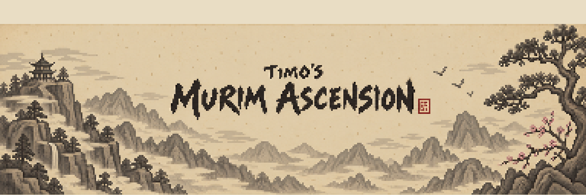

# Timo's Murim Ascension

**Murim / wuxia martial-arts cultivation for Minecraft** — form a dantian, gather qi, find sword
manuals in ruined libraries, master every art up to **twelve stars** and climb from Third Rate
toward the realms beyond — as a disciple of the **Mount Hua sect**.


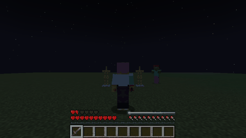

<sub>If you like where this is going, a ⭐ helps other murim fans find it.</sub>

</div>

## ✦ What it is

A murim (Korean/Chinese martial-arts fantasy) mod built around **techniques that look and
feel like the manhwa**: every form is a particle simulation — petals, wind, smoke, impact
frames — not a flat texture, and every technique grows with your mastery.

**For fans of** *Return of the Mount Hua Sect*, *Absolute Regression*, *Nano Machine*,
*Myst, Might, Mayhem* and *The Breaker* — plum blossom swordsmanship, Tang clan hidden weapons,
Heavenly Demon arts, qi cultivation and footwork, in survival Minecraft. Plays alongside other
combat mods; few keybinds, built to sit in a modpack.

## ✦ Features

### Cultivation
- Form a **dantian**, gather qi into a reserve and circulate it; **meditate** to refine it.
- **Cultivation methods** with their own nature of energy.
- **Breakthroughs** between ranks, each with its own scene; stronger masters press you with
  their **aura**.

| Breakthrough | Aura pressure |
|:---:|:---:|
| 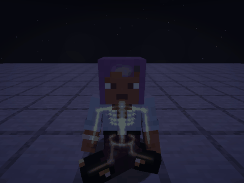 | 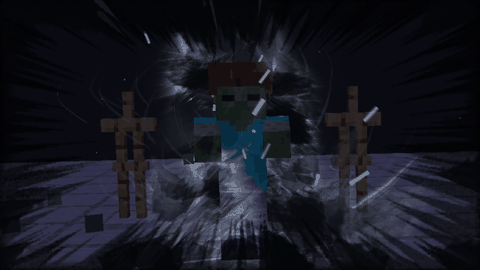 |

### Techniques and mastery — twelve stars
- Every art is mastered in **stars, up to ★12** — the completion of any art. You earn them in fights,
  training, sparring and meditation; the last stars need **insight**, not just practice.
- At zero stars a form is a clumsy motion; speed, qi cost, power and visual effects grow with every star.
- **Style manuals** (pixel-art books): the style's title, the style itself, then every form —
  learned in order, each harder than the last.

<p align="center">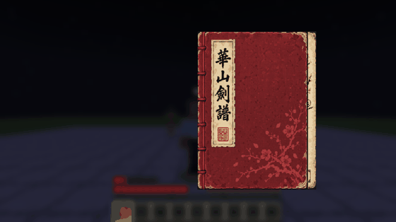</p>

### Mount Hua sword
**Seven Plum Blossoms Sword** — seven forms: Cut · Palisade, Whirlwind, Execution, Rush,
Plum Blossom Shower, Plum Blossom Explosion.

| Cut · Palisade | Whirlwind |
|:---:|:---:|
|  | 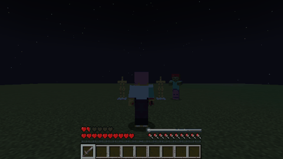 |
| **Plum Blossom Shower** | **Plum Blossom Explosion** |
| 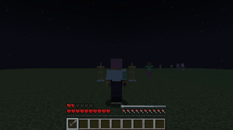 |  |

**Twenty-Four Plum Blossom Movements** — the secret art: Rainfall, Dome, Scatter, River.

| Dome | Scatter |
|:---:|:---:|
| 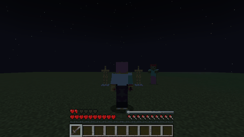 |  |

Also: **Falling Petal Sword**, **Six Harmonies Sword**, **Demon Destruction Palm**.

### Tang clan hidden weapons
Real flying daggers that track, curve and hit by contact: **Five Successive Lightning Strikes**,
**Soul-Stealing Seven Stars**, **Dark Eruption Dagger** — with recall, a second dagger that doubles the first,
and counterplay for the enemy.

### Pills and places of power
Eat a pill and sit down to meditate in time — guide the flow of its qi through your meridians with the mouse
(calm or wild, short path or detour); succeed and it works ten times stronger, combine up to three rare pills.
Spirit-vein stones, old trees, peaks and running water speed up meditation — at a risk.

### Footwork
Footwork is a style of its own forms: evade, run, shadow, strike-through
(Dark Fragrance, Wind God Steps). Double-tap to evade, sprint to run, crouch still to fade.

### Mount Hua sect
- A whole sect on a generated **Mount Hua**: gate, training square, halls on stepped terraces, a disciples' camp,
  elders and servants who live by a daily schedule (drills, meals, evening, night watch).
- Join as a newcomer: the mentor gives you an inner method, you plant your qi seed and learn the
  **Six Equilibriums**; one clear next goal is always shown. The sect invites, it never punishes you for
  adventuring elsewhere.
- Sparring partners, reviews, sect merit and a merit shop, ranks inside the sect.
- The full sect is built: a three-tier **main hall**, the hall of ancestors, the scripture pavilion, a bell
  tower, the treasury with a vault, a long dining hall and kitchen, three-storey disciple dorms with rooms,
  the alchemy house, the elders' walled courtyards and pavilions on the surrounding peaks.
- Disciples and elders **walk** everywhere (no teleporting): to drills, meals, their own beds and posts.
  Guards change shifts with a bow, newcomers are met at the gate and escorted on foot. Multiplayer-aware:
  every player gets their own bed and joins the same ceremony.
- Misbehave inside the sect and an elder arrives, pins you with his aura and takes you to the cell.

<p align="center">
  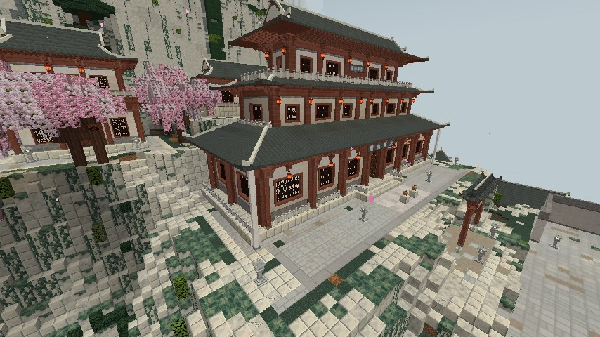
  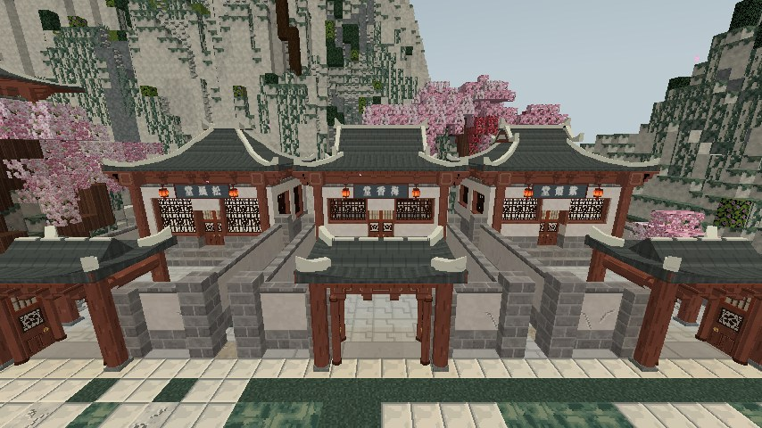
</p>

### Building and interior blocks
- A wuxia building kit: solid tiled roofs with eaves, ridges and gable panels, red and white pillars,
  lattice windows and transoms, plaster and grey-brick walls, stone and silk lanterns, a bronze bell.
- Interior furniture from manhwa references: floor cushions, tea and dining tables, benches, shrine
  pieces, storage racks and chests.
- Courtyard floors: granite tiles, slabs and thin 4 px layers, a white kerb with cracked and chipped variants.

### Ruined library
<p align="center">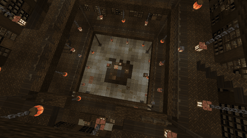</p>

- A buried four-tier archive behind a cave mouth: parquet galleries, lattice railings, a coffered ceiling and
  hundreds of small lights.
- **Hidden manuals** sit among ordinary books — look for the one that sticks out with a pale outline and pull it
  out. One bookcase is propped up with a very old book…

<p align="center">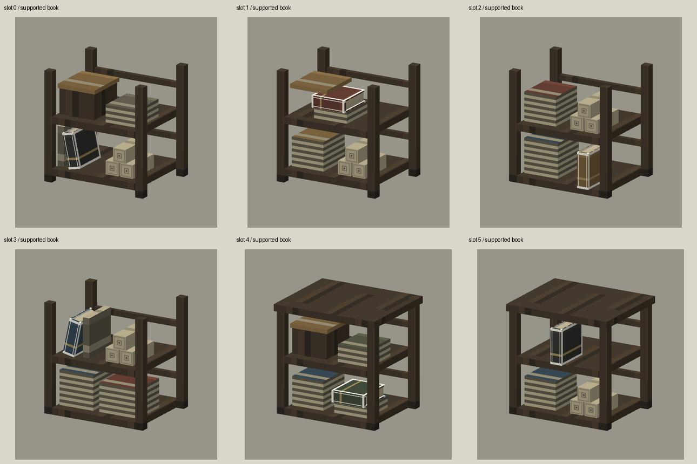</p>

### Combat
- **Basic sword combo** with a finisher: the blade's crescent trail follows the real sword.

<p align="center">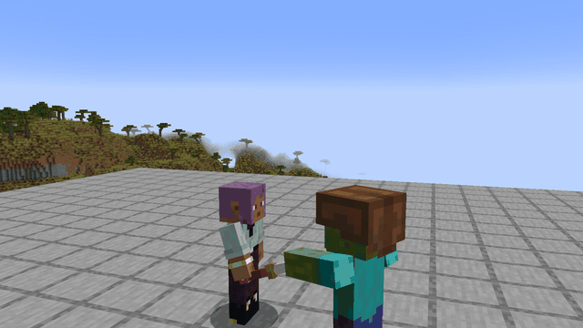</p>

- **Lock-on**: the camera follows the target; rushes and thrusts reach enemies in the air.
- **Technique wheel** with sub-forms, per-technique cooldowns, stuns that really stop the enemy.
- Sword arts need a sword — without one you fight with a **qi-sword**.
- **Bandits** (swordsman, archer) with readable wind-ups; some know a weak qi technique.

## ✦ Controls

| Key | Action |
|---|---|
| `R` | use the selected technique |
| `V` (hold) | technique wheel |
| `K` | technique scroll (loadout) |
| `Z` | lock on |
| `G` | meditate |
| double-tap `A` / `D` / `S` | footwork evade |

All keys can be rebound. All in-game texts are in **English** and **Russian**.

## ✦ Build

```bash
./gw build        # finds a JDK 21 for you; or ./gradlew build
./gw runClient
```

The jar lands in `build/libs/`.

## ✦ Roadmap

- [x] Cultivation, ranks and breakthroughs
- [x] Mount Hua sword styles, footwork, manuals
- [x] Lock-on combat, bandits
- [ ] Rank power, bandit camp and the first loop (find a manual → learn → fight → break through)
- [ ] A boss
- [x] Pills (absorption mini-game) and places of power
- [x] Ruined library with hidden manuals
- [x] Twelve-star mastery for every art
- [ ] Cult strongholds built from modular pieces
- [x] Tang clan hidden weapons (first three forms)
- [x] Mount Hua sect: location, masters, training, sect life
- [ ] Player-vs-player duels with techniques (in design)
- [ ] Other schools

## ✦ License

- **Code** — [LGPL-3.0](LICENSE): use it, learn from it, write addons; changes to the mod itself stay open.
- **Assets** — [All Rights Reserved](ASSETS_LICENSE.md): textures, models, animations, sounds, the name and
  logo. Videos, streams and modpacks that link back to the official page are welcome.

Technique and rank names are murim genre vocabulary; no third-party artwork is included in this repository.

---

<sub>По-русски: мод в жанре мурим для Minecraft 1.21.1 (NeoForge) — культивация ци,
манускрипты техник и освоение до двенадцати звёзд, стили меча Хуашань, секта горы Хуа, разрушенная
библиотека со спрятанными манускриптами, шаги, захват цели, бандиты.
Все тексты в игре — на русском и английском.</sub>
