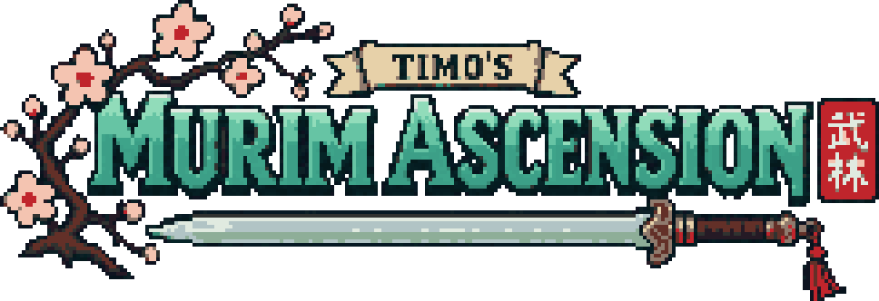

# Timo's Murim Ascension

[Русский](README.ru.md)

A murim / martial-arts cultivation mod centred on Mount Hua. Join the sect, learn arts
star by star, cultivate qi, break through ranks, and fight bandits and one boss.

## In 0.1.0

- Mount Hua has disciples and staff with daily routines, lessons, sparring, contracts,
  merit, trade and sect positions.
- Arts gain stars through practice and insight. Sword arts, palm arts, hidden weapons,
  footwork and breathing methods are available.
- Form a dantian, meditate to cultivate qi, and meet the requirements for breakthroughs.
- Gather herbs and use pills to support cultivation.
- Explore bandit camps and the fortress, where the Fortress Master is the boss.
- English and Russian text; player animations use the bundled PlayerAnimationLib.

## Install

Use Minecraft Java Edition **1.21.1**, **NeoForge 21.1.248 or newer in 21.1.x**,
and **Java 21**. Put the 0.1.0 mod jar in your instance's `mods` folder.
Install one jar: PlayerAnimationLib is bundled. On a server, install the mod on both
server and clients.

## First steps

Start in a new world. Mount Hua is in the Overworld; by default its centre is
2,700–4,800 blocks from world spawn. A wandering Mount Hua disciple can help you find
the sect. Speak to the gatekeeper, climb the mountain and follow the reception dialogue
to join. Follow your mentor's lessons and the sect's instructions.

Default keys (change them in Minecraft's Controls):

| Key | Action |
| --- | --- |
| R | Use technique |
| G | Meditate; with an art in hand, Echo; while sneaking, no qi filtering |
| Hold V | Choose a technique with the wheel |
| K | Technique loadout |
| Z | Lock on / release target |

Epic Fight uses the same keys R, G and K; rebind them in Options → Controls.

## Compatibility

Single-player comes first. Dedicated servers are supported; combat is controlled by
the server. Broad modpack compatibility has not been established. Distant chunk
pregeneration during server startup is an unverified interaction; see
[Mount Hua placement notes](docs/adr/0004-baked-hua-sect.md).
See also the [wave-one vanilla compatibility decisions](docs/adr/0086-wave-one-vanilla-compatibility.md).

## Licence and credits

Code: [LGPL-3.0-only](LICENSE), with [COPYING](COPYING). Assets:
[All Rights Reserved](ASSETS_LICENSE.md), subject to the third-party exceptions in
[PROVENANCE.md](PROVENANCE.md). MDK template files retain [MIT](TEMPLATE_LICENSE.txt).
Read [PROVENANCE.md](PROVENANCE.md) for asset origins, AI disclosure and the unofficial
fan-work notice.

## For developers

### Build and run

Run Gradle through `./gw`, not `./gradlew`: the wrapper finds JDK 21 and sets `JAVA_HOME`.

```bash
./gw build                # full build with unit tests (the first run downloads and decompiles Minecraft)
./gw test                 # JUnit unit tests only
./gw runData              # data generation into src/generated/resources (never edit that folder by hand)
./gw runGameTestServer    # headless GameTests; the exit code lies, read run/logs/latest.log
./gw runServer            # dedicated server (catches client-only classes in common code)
./gw runClient            # needs a GPU and a display
```

### Layout

| Path | What it is |
|---|---|
| `src/main/java/.../murim/` | mod code: `cultivation`, `technique`, `mastery`, `sect`, `world`, `client`, ... |
| `src/main/resources/` | assets and hand-written data; `src/generated/resources/` is data generator output |
| `docs/` | knowledge base (start at [docs/INDEX.md](docs/INDEX.md)), design documents in `docs/design/`, decisions in `docs/adr/` and `docs/DECISIONS.md` |
| `tools/` | art, capture and baking scripts |
| `CLAUDE.md`, `.claude/rules/` | rules for the AI agent that works in this repository |

### Two machines (Две машины)

Development and execution are split by necessity (ADR-73 in [docs/DECISIONS.md](docs/DECISIONS.md)).
The Linux server has no GPU: it runs `compileJava`, `runData`, tests and a software-rendered capture
stand. Anything visual (`runClient`, final judgement of effects) runs on the Mac, `timomac`. The two
machines sync through GitHub (`git push` here, `git pull` there), not by copying sources.

### Credits and third-party software

- [Player Animation Library](https://github.com/ZigyTheBird/PlayerAnimationLibrary) by Zigy and
  dima_dencep, **MIT licence**. It animates the player body for techniques and meditation. The unmodified
  library is bundled inside the mod jar (`META-INF/jarjar/`), together with its own nested libraries
  (mochafloats, Javassist). The licence text and notices travel in the jar as
  `META-INF/licenses/THIRD_PARTY_NOTICES.txt` (source: `src/main/resources/META-INF/licenses/`).
