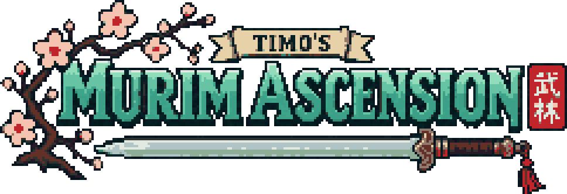

# Timo's Murim Ascension

[English](README.md)

Мод о муриме, боевых искусствах и культивации, в центре которого — Хуашань.
Вступайте в секту, осваивайте искусства звезда за звездой, накапливайте ци,
совершайте прорывы между рангами и сражайтесь с разбойниками и одним боссом.

## Что есть в 0.1.0

- Секта Хуашань: ученики и работники с распорядком дня, уроки, спарринги,
  поручения, заслуги, торговля и должности.
- Освоение искусств через практику и озарения. Доступны искусства меча,
  ладони, скрытого оружия, передвижения и методы дыхания.
- Формирование даньтяня, медитация для накопления ци и прорывы с условиями допуска.
- Сбор трав и пилюли, помогающие культивации.
- Лагеря разбойников и крепость с боссом — Хозяином крепости.
- Тексты на русском и английском; анимации игрока работают через встроенную PlayerAnimationLib.

## Установка

Нужны Minecraft Java Edition **1.21.1**, **NeoForge 21.1.248 или новее в ветке 21.1.x**
и **Java 21**. Положите jar мода версии 0.1.0 в папку `mods` своей сборки.
Устанавливается один jar: PlayerAnimationLib уже внутри. Для игры на сервере мод
нужен и на сервере, и у игроков.

## Первые шаги

Начните в новом мире. Хуашань находится в Верхнем мире: по умолчанию центр горы
выбирается в 2700–4800 блоках от точки появления мира. Странствующий ученик Хуашань
поможет найти секту. Поговорите с привратником, поднимитесь на гору и следуйте диалогу
приёма, чтобы вступить. Дальше следуйте урокам наставника и указаниям секты.

Клавиши по умолчанию можно изменить в настройках управления Minecraft:

| Клавиша | Действие |
| --- | --- |
| R | Применить технику |
| G | Медитировать; с искусством в руке — Эхо; крадучись — без отсева примесей ци |
| Удерживать V | Выбрать технику в кольце |
| K | Раскладка техник |
| Z | Захватить / отпустить цель |

Epic Fight использует те же клавиши R, G и K; переназначьте их в Настройки → Управление.

## Совместимость

В первую очередь мод рассчитан на одиночную игру. Выделенный сервер поддерживается;
боёвкой управляет сервер. Совместимость с большими сборками модов ещё не установлена.
Предварительная генерация дальних чанков при запуске сервера — непроверенное
взаимодействие; см. [размещение Хуашань](docs/adr/0004-baked-hua-sect.md).
См. также [решения волны 1 о совместимости с ванилью](docs/adr/0086-wave-one-vanilla-compatibility.md).

## Лицензии и авторство

Код: [LGPL-3.0-only](LICENSE), полный текст GPL — [COPYING](COPYING).
Ассеты: [все права защищены](ASSETS_LICENSE.md), с исключениями для сторонних
материалов из [PROVENANCE.md](PROVENANCE.md). Шаблон MDK сохраняет [MIT](TEMPLATE_LICENSE.txt).
Происхождение материалов, использование ИИ и статус неофициальной фанатской работы
описаны в [PROVENANCE.md](PROVENANCE.md).

## For developers

Информация о сборке, структуре репозитория, двух машинах и сторонних библиотеках
сохранена в разделе [For developers английского README](README.md#for-developers).
